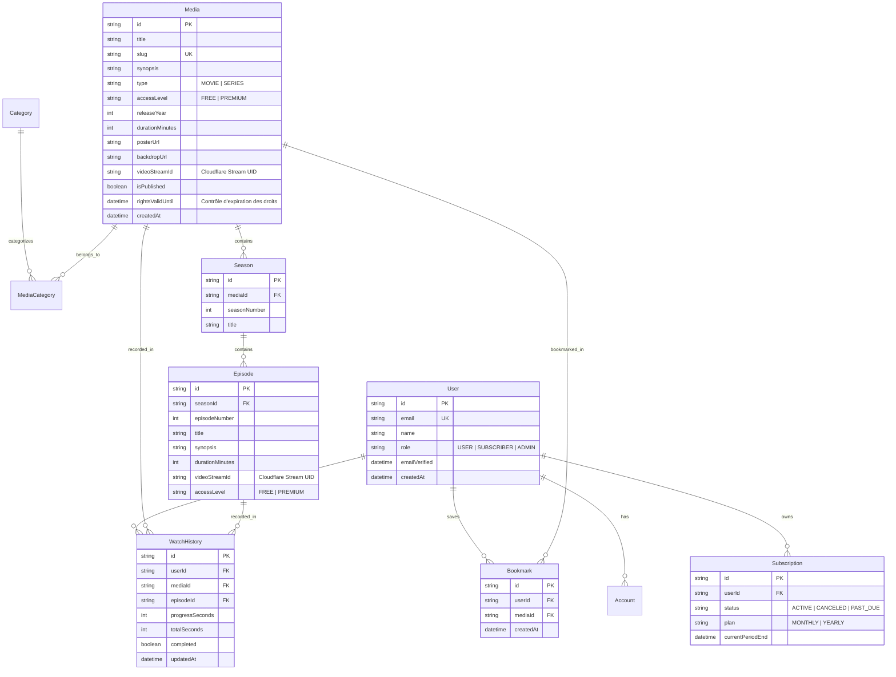
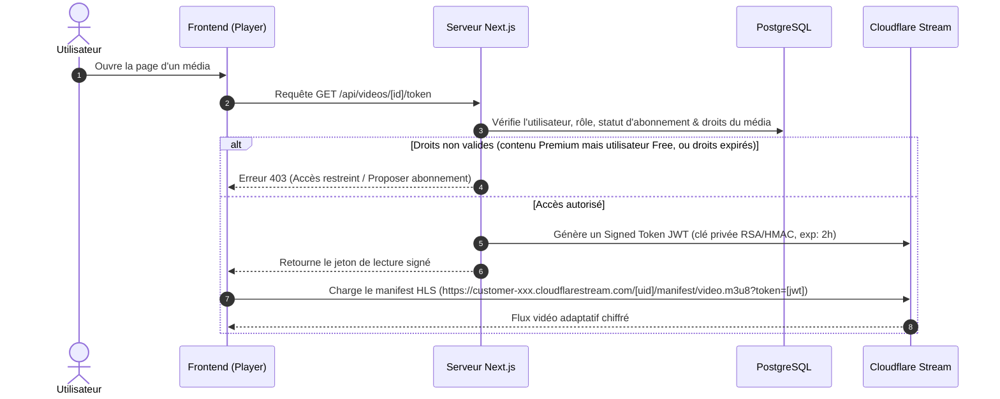
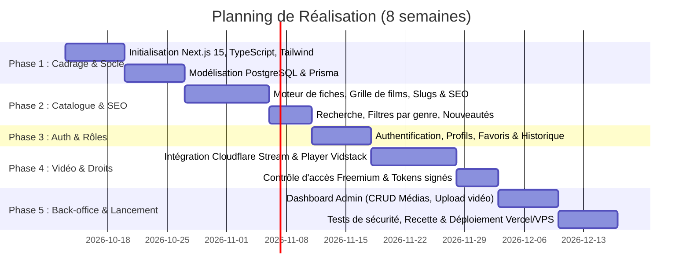

# Spécification Technique Détaillée — Plateforme de Streaming Vidéo

**Version :** 1.0.0  
**Statut :** Validé pour implémentation  
**Date :** 12 Octobre 2026  
**Modèle Économique :** Freemium (Catalogue public gratuit + Contenus exclusifs Premium)  
**Pipeline Vidéo :** Cloudflare Stream (HLS / DASH, Signed Tokens, Transcodage automatique)  
**Stack Principale :** Next.js 15 (App Router), TypeScript, PostgreSQL (Prisma ORM), Tailwind CSS  

---

## 1. Contexte & Architecture Globale

### 1.1. Objectifs
- Offrir une expérience de streaming fluide, réactive et multi-appareils (desktop, tablette, mobile).
- Maximiser l'acquisition naturelle grâce à un référencement naturel (SEO) optimisé pour les fiches films et séries.
- Mettre en place un modèle **Freemium** fiable avec contrôle d'accès strict côté serveur.
- Garantir un coût de fonctionnement maîtrisé grâce au stockage et à la distribution via Cloudflare Stream.

### 1.2. Architecture Système

```mermaid
flowchart TD
    subgraph Client ["Client (Navigateur Web / Mobile)"]
        UI["Interface Next.js (React / Tailwind)"]
        Player["Lecteur Vidéo HLS / Vidstack / Plyr"]
    end

    subgraph Edge ["Réseau Edge & CDN (Cloudflare)"]
        CF_CDN["Cache CDN & Proxy"]
        CF_Stream["Cloudflare Stream (HLS/DASH + Player)"]
    end

    subgraph AppServer ["Serveur d'Application (Next.js App Router)"]
        RSC["React Server Components (SEO & Rendu rapide)"]
        API["Route Handlers & Server Actions"]
        AuthMiddleware["Middleware de Sécurité & Session"]
    end

    subgraph Storage ["Couche Données"]
        DB[(PostgreSQL - Neon / Supabase / VPS)]
        Prisma["Prisma ORM"]
    end

    Client -->|Requêtes HTTP / Page Load| CF_CDN
    CF_CDN --> AppServer
    AppServer --> Prisma
    Prisma --> DB
    Player -->|Flux HLS signé (Token HMAC)| CF_Stream
    API -->|API Token / Signatures TUS| CF_Stream
```

---

## 2. Choix Technologiques & Justifications

| Composant | Technologie | Justification |
| :--- | :--- | :--- |
| **Framework Web** | Next.js 15 (App Router, React 19) | Rendu hybride (SSR/SSG) indispensable pour le SEO des fiches films, rapidité client avec Server Actions. |
| **Langage** | TypeScript (Strict mode) | Typage fort pour la manipulation des métadonnées vidéo, droits d'accès et payload API. |
| **Base de Données** | PostgreSQL | Robustesse transactionnelle, gestion des relations complexes (saisons, épisodes, abonnements, historique). |
| **ORM** | Prisma | Typage de bout en bout, migrations déclaratives claires, requêtes optimisées. |
| **Authentification** | Auth.js (NextAuth v5) / Lucide Auth | Sessions sécurisées avec cookies HTTP-only, gestion des rôles (USER, SUBSCRIBER, ADMIN). |
| **Hébergement Vidéo** | Cloudflare Stream | Transcodage automatique multi-résolutions, lecteur HLS/DASH adaptatif, jetons signés avec expiration, coût prévisible. |
| **Player Vidéo Frontend** | Vidstack Player ou Plyr | Compatible HLS.js, personnalisable, accessible au clavier, support natif mobile et Picture-in-Picture. |
| **Design & UI** | Tailwind CSS + Radix UI (Shadcn) | UI moderne et accessible (thème sombre par défaut adapté au streaming). |
| **Validation** | Zod | Validation stricte des entrées utilisateurs, webhooks et formulaires back-office. |

---

## 3. Modèle de Données (Schéma PostgreSQL)



---

## 4. Pipeline et Sécurité de Diffusion Vidéo

### 4.1. Flux d'Upload (Back-office)
1. L'administrateur crée une fiche média (titre, synopsis, niveau d'accès `FREE` ou `PREMIUM`).
2. Demande d'un URL de téléversement direct (*Direct Creator Upload*) via l'API Cloudflare Stream (protocole TUS).
3. Cloudflare Stream transcode la vidéo en résolutions adaptatives (360p, 720p, 1080p) et génère les vignettes temporelles.
4. Un webhook ou une mise à jour d'état notifie l'application lorsque le traitement est terminé (`status: ready`).

### 4.2. Autorisation et Lecture Sécurisée


---

## 5. Stratégie SEO & Acquisition

### 5.1. URLs Canoniques et Slugs
- Films : `/films/[slug]` (ex: `/films/l-arbre-aux-esprits`)
- Séries : `/series/[slug]` (ex: `/series/les-chroniques-du-sahel`)
- Épisodes : `/series/[slug]/saison-[seasonNum]/episode-[epNum]`

### 5.2. Métadonnées Dynamiques & OpenGraph (Next.js `generateMetadata`)
- Titre optimisé : `{Titre du film} | Regarder en streaming légal sur {Plateforme}`
- Description : Synopsis court (150-160 caractères) avec mentions d'acteurs/réalisateurs.
- Balises OpenGraph : Images au ratio 16:9 (`og:image`), type `video.movie` ou `video.tv_show`.

### 5.3. Données Structurées JSON-LD (Schema.org)
Injection automatique dans chaque page pour affichage enrichi dans Google :
```json
{
  "@context": "https://schema.org",
  "@type": "Movie",
  "name": "Titre du Film",
  "description": "Synopsis du film...",
  "image": "https://domaine.com/posters/film.jpg",
  "datePublished": "2024-05-10",
  "duration": "PT1H45M",
  "inLanguage": "fr",
  "potentialAction": {
    "@type": "WatchAction",
    "target": "https://domaine.com/films/titre-du-film"
  }
}
```

### 5.4. Fichiers Systèmes SEO
- `robots.ts` : Autorise `/films/`, `/series/`, `/nouveautes`, interdit `/admin/`, `/mon-compte/`, `/api/`.
- `sitemap.ts` : Génération dynamique des URLs actives uniquement (excluant les contenus non publiés ou expirés).

---

## 6. Critères de Validation & Matrice de Tests

| Domaine | Test Clé | Critère d'Acceptation |
| :--- | :--- | :--- |
| **Authentification** | Inscription & Connexion | Mots de passe hachés (Argon2/Bcrypt), sessions chiffrées, pas de fuite de tokens en console. |
| **Contrôle d'Accès** | Contenu Premium | Un utilisateur non abonné ne reçoit jamais l'URL de lecture ou le token Cloudflare. |
| **Expiration Droits** | Licence expirée | Si `rightsValidUntil < now()`, la vidéo est inaccessible et un message clair est affiché. |
| **Progression** | Reprise de lecture | La position est synchronisée toutes les 10 secondes et restaurée au rechargement. |
| **SEO** | Lighthouse & Mobile | Score SEO > 95, balises `canonical`, `og:image` et `schema.org` valides sur Rich Results Test. |
| **Lecteur Vidéo** | Multi-écrans & Réseau | Débit adaptatif automatique selon la connexion, contrôles accessibles au clavier (Espace, Flèches, F). |

---

## 7. Plan d'Implémentation Étape par Étape


